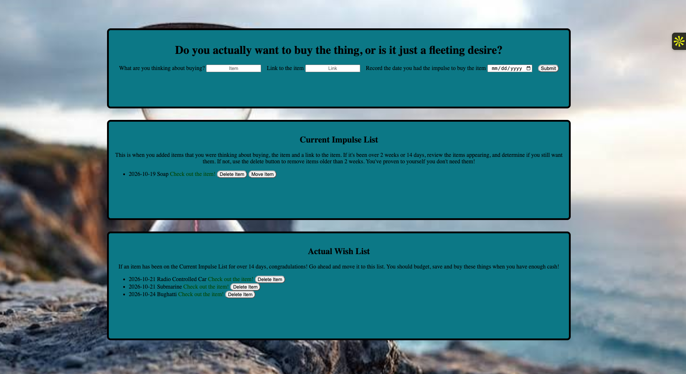

# ☀️ Fullstack Impulse vs Wish List
Use this program if you want to track things you actually want to buy!  

# Link
https://personal-wish-list-fullstack-app.onrender.com/

# 📋 How to use
Download files.   
Enter an item you had an impulse to buy.    
Wait 2 weeks, if you continue wanting to buy the item, move it to your buy list and treat yourself when you can afford it!  

# 📷 Images

# ✨ Features
Fully responsive design for desktop and mobile.         

# 🔨 Built With
HTML5 – structure,    
CSS3 – responsive design and background,    
JavaScript - frontend and backend.  
Node - backend.  

# 🧠 What I Learned
How to work with Node.    
How to work with APIs.   
How to use fetch().   
How to work with JSON data.  
How to manipulate the DOM.  
How to handle errors.  
